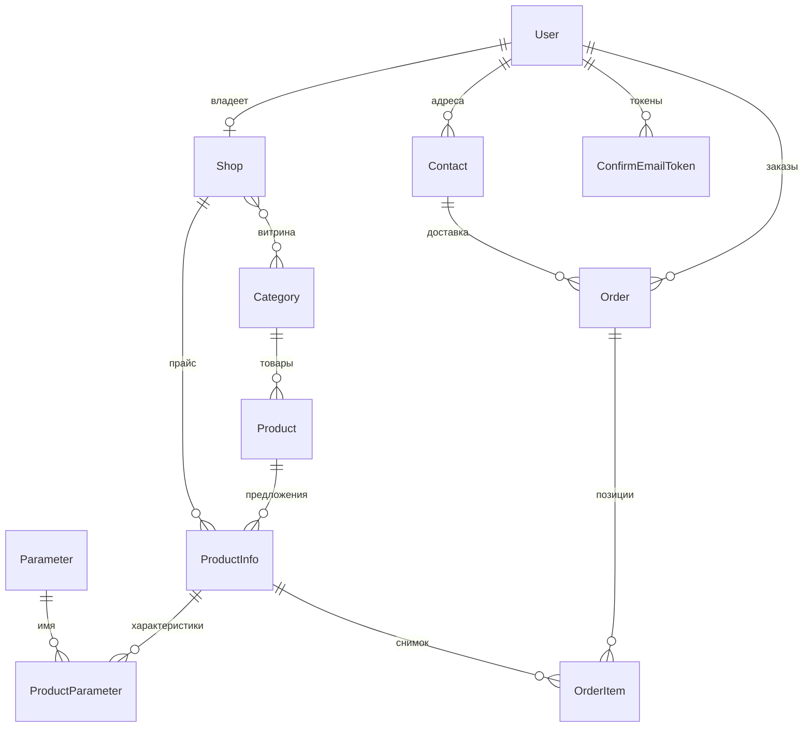

# Документация проекта: сервис заказа товаров

Дипломный проект профессии «Python-разработчик: расширенный курс» (Нетология).  
Репозиторий: сервис автоматизации закупок в розничной сети.

Это **оригинальный REST-сервис**, а не копия HTML-магазина и не копия эталона `reference/netology_pd_diplom`. Клиенты API — покупатель и поставщик. Склад работает в Django Admin. Поверх API есть SPA на Angular 20.

| Документ | Что внутри |
| --- | --- |
| [README.md](README.md) | задание Нетологии, краткий запуск, curl-сценарий |
| [architecture.md](architecture.md) | слои бэкенда, потоки данных, Docker |
| [backend/README.md](backend/README.md) | домен, YAML, API, тесты |
| [frontend.md](frontend.md) | бриф SPA: FSD, экраны, правила слоёв |
| [frontend/README.md](frontend/README.md) | запуск фронтенда |

---

## 1. Что умеет система

**Покупатель (`buyer`)** регистрируется по email, подтверждает аккаунт токеном из письма, смотрит каталог предложений нескольких магазинов, кладёт товары в корзину (в одном заказе — разные поставщики), указывает адрес доставки, оформляет заказ и следит за статусом.

**Поставщик (`shop`)** загружает YAML-прайс (upsert), включает или выключает витрину, выгружает прайс обратно, видит заказы со своими товарами и меняет статус.

**Сотрудник склада (`is_staff`)** работает в `/admin/`: пользователи, магазины, прайсы, заказы, смена статуса (то же письмо, что и у API).

Выполнено:

- этапы 1–5 (базовый backend);
- этап 6 — админка склада;
- этап 7 — Celery `send_email` и `do_import`;
- этап 8 — Docker Compose (web, worker, Postgres, Redis);
- опциональный экспорт YAML `GET /api/v1/partner/export`;
- SPA витрины и кабинетов (Angular 20, Feature-Sliced Design, PrimeNG).

Не входит в SPA: складская админка (остаётся Django), загрузка YAML с диска через API (файл — только admin), платежи, карты, полнотекстовый поиск.

---

## 2. Стек

| Слой | Технология |
| --- | --- |
| HTTP API | Django 5.2, Django REST Framework, Token Authentication (`Authorization: Token …`) |
| Схема API | drf-spectacular: OpenAPI `/api/schema/`, Swagger `/api/docs/` |
| Админка | Django Admin, заголовок «Админка склада» |
| Домен | пакет `backend.services` |
| Очередь | Celery 5 + Redis 7 (`send_email`, `do_import`) |
| БД локально | SQLite (`DATABASE_URL=sqlite:///db.sqlite3`) |
| БД в Docker | PostgreSQL 16 |
| Почта (разработка) | console backend — письма в stdout `runserver` / логи `worker` |
| HTTP в Docker | gunicorn, `orders_service.wsgi:application` |
| Конфиг | `.env` + `python-dotenv` |
| SPA | Angular 20 (standalone), PrimeNG 20 Aura, сигналы, FSD |

Пользователь задан до первой миграции: `AUTH_USER_MODEL = 'backend.User'`. Вход по **email**, поля `username` нет.

---

## 3. Карта репозитория

```
python-final-diplom/
├── manage.py
├── requirements.txt
├── .env.example              шаблон (в git)
├── .env                      секреты (не в git)
├── Dockerfile                web и worker, migrate не на сборке
├── docker-compose.yml        db, redis, web, worker
├── docker/web.sh             migrate + collectstatic + gunicorn
├── docker/worker.sh          celery worker (migrate не вызывает)
├── data/shop1.yaml           прайс «Связной»
├── data/shop2.yaml           прайс «М.Видео»
├── orders_service/           настройки Django, WSGI, Celery
├── backend/                  домен: модели, API, сервисы, админка, тесты
├── frontend/                 Angular SPA
└── reference/                материалы задания Нетологии (не runtime)
```

Не коммитятся: `venv/`, `db.sqlite3`, `media/`, `staticfiles/`, `.env`, `frontend/node_modules/`.

### Слои бэкенда

```
HTTP → orders_service.urls
     → backend.urls
       → backend.views.*      права, JSON
         → backend.services.* транзакции, письма, импорт
           → backend.models
```

View не пишет в БД напрямую и не парсит YAML. Ошибка домена — `ServiceError` → `{"Status": false, "Errors": "..."}`.

---

## 4. Запуск

Нужны Python 3.10+ и (для SPA) Node 20+ (`nvm use 22`).

### 4.1. Локально (SQLite, Celery eager)

```bash
python3 -m venv venv
source venv/bin/activate
pip install -r requirements.txt
cp .env.example .env
```

В `.env` задайте свой `SECRET_KEY`. Остальное можно оставить как в примере.

```bash
python manage.py migrate
python manage.py createsuperuser
python manage.py import_shop data/shop1.yaml --email shop@example.com
python manage.py changepassword shop@example.com
python manage.py import_shop data/shop2.yaml --email mvideo@example.com
python manage.py changepassword mvideo@example.com
python manage.py runserver
```

| URL | Что |
| --- | --- |
| http://127.0.0.1:8000/admin/ | админка склада |
| http://127.0.0.1:8000/api/docs/ | Swagger |
| http://127.0.0.1:8000/api/v1/ | REST API |

Фронтенд (второй терминал, бэкенд уже на `:8000`):

```bash
cd frontend
nvm use 22
npm install
npm start
```

SPA: http://127.0.0.1:4200/. Прокси `/api` и `/admin` → `http://127.0.0.1:8000`.

Письма (токен confirm, заказ, накладная) печатаются в терминале `runserver`.

### 4.2. Docker Compose

Сервисы: `web` (gunicorn, migrate при старте), `db` (Postgres), `redis`, `worker` (Celery).  
Compose **перебивает** `DATABASE_URL` и Celery на хосты `db` / `redis`, даже если в `.env` SQLite и eager. Миграции — в `docker/web.sh`, не в Dockerfile. Worker ждёт healthy `web`, чтобы не гоняться за migrate.

```bash
cp .env.example .env
docker compose up --build
```

Те же URL на порту 8000. Остановить: `docker compose down`. Данные Postgres — volume `postgres_data`, загрузки прайса — `media_data`.

```bash
docker compose exec web python manage.py createsuperuser
docker compose exec web python manage.py import_shop data/shop1.yaml --email shop@example.com
docker compose exec web python manage.py changepassword shop@example.com
docker compose logs -f web worker
```

Локальный `venv` в образ не попадает (`.dockerignore`).

### 4.3. Учётные данные для проверки

Суперпользователь создаёте сами (`createsuperuser`). Логин админки и API — **email**.

Пример, если уже создан локально:

| Кто | Email | Пароль | Где |
| --- | --- | --- | --- |
| staff | тот, что указали в `createsuperuser` | тот же | `/admin/`, API |
| магазин | `shop@example.com` | задаётся `changepassword` | API `/partner/*`, SPA `/partner` |
| покупатель | любой после register + confirm | свой | SPA и API |

Регистрация через API всегда делает `type=buyer`, `is_active=False`. Пока email не подтверждён, логин не проходит.

---

## 5. Роли

| Тип | Как появляется | Что может |
| --- | --- | --- |
| `buyer` | `POST /user/register` | контакты, корзина, свои заказы |
| `shop` | админка или `import_shop` | прайс, витрина, заказы своего магазина, экспорт YAML |
| сотрудник (`is_staff`) | `createsuperuser` / админка | админка склада, смена статуса любого заказа |

Авторизация API: заголовок `Authorization: Token <ключ>`. Ключ возвращает `POST /user/login` в поле `Token`.

Права: `IsBuyer`, `IsShopUser`, `IsShopOrStaff` (`backend/permissions.py`).

---

## 6. Модели

Вход по email. Корзина — это `Order` со статусом `basket`. Цена позиции (`OrderItem.price`) копируется с предложения в момент добавления в корзину и при оформлении не меняется вместе с прайсом.



| Модель | Назначение |
| --- | --- |
| `User` | email, `type` (`buyer` / `shop`), `company`, `position`, `is_active` |
| `Shop` | `state=False` — витрина выключена, заказы не принимаются |
| `Category` | категория; M2M с магазинами |
| `Product` | товар каталога (имя + категория), без цены |
| `ProductInfo` | предложение магазина: `external_id` из YAML, цена, РРЦ, остаток |
| `Parameter` / `ProductParameter` | характеристики (диагональ, цвет, …) |
| `Contact` | адрес доставки, не больше 5 на пользователя |
| `Order` | корзина или заказ; `total_sum` = Σ(price × quantity) |
| `OrderItem` | позиция со снимком цены |
| `ConfirmEmailToken` | одноразовый ключ подтверждения регистрации |

Уникальность: `(product, shop, external_id)`, `(order, product_info)`, `(product_info, parameter)`.

### Статусы заказа

`basket` → `new` → `confirmed` → `assembled` → `sent` → `delivered`. Отмена: `canceled`.  
`basket` — служебный статус корзины, через API смены статуса его выставить нельзя.

---

## 7. YAML-прайс

Один файл — один магазин. Импорт — **upsert**. Предложений, которых больше нет в файле, удаляются; если на них уже есть `OrderItem`, остаток обнуляется (`quantity=0`), история заказов не ломается.

Обязательные поля корня: `shop`, `categories`, `goods`.  
Категория: `id`, `name`.  
Товар: `id`, `category`, `name`, `price`, `price_rrc`, `quantity`. Необязательно: `model`, `parameters`.

```yaml
shop: Связной
categories:
  - id: 224
    name: Смартфоны
goods:
  - id: 4216292
    category: 224
    model: apple/iphone/xs-max
    name: Смартфон Apple iPhone XS Max 512GB (золотистый)
    price: 110000
    price_rrc: 116990
    quantity: 14
    parameters:
      "Диагональ (дюйм)": 6.5
      "Цвет": золотистый
```

Примеры: `data/shop1.yaml` (Связной), `data/shop2.yaml` (М.Видео). Для корзины из двух магазинов нужны оба.

`id` товара в YAML → `ProductInfo.external_id`. В корзину кладётся внутренний `ProductInfo.id` из `GET /products`, не YAML-id.

Импорт доступен только `type=shop`. Если магазина нет, он создаётся и привязывается к этому пользователю.

### Как загрузить прайс

1. Команда: `python manage.py import_shop data/shop1.yaml --email shop@example.com`
2. API: `POST /api/v1/partner/update` с `{"url": "https://.../price.yaml"}` (URL сохраняется у магазина)
3. Админка: карточка магазина → «Импортировать прайс» → файл или URL. Файл пишется в `media/imports/`, задача `do_import` читает **путь** (байты в Celery не передаются)
4. Список магазинов в админке: действие «Импортировать прайс» — если у магазина уже есть URL
5. Экспорт: `GET /api/v1/partner/export` (токен магазина) → YAML того же формата

---

## 8. REST API

Базовый префикс: `/api/v1/`. Интерактивно: `/api/docs/`.

Успех мутаций обычно `{"Status": true, ...}`. Ошибка: `{"Status": false, "Errors": "..."}` и 400/403/404. Каталог и детали заказа отдают объекты сериализаторов без обёртки `Status`.

### Покупатель и аккаунт

| Метод | Путь | Доступ | Назначение |
| --- | --- | --- | --- |
| POST | `/user/register` | аноним | регистрация покупателя |
| POST | `/user/register/confirm` | аноним | `email` + `token` из письма |
| POST | `/user/login` | аноним | `email`, `password` → `Token` |
| GET / POST | `/user/details` | авторизованный | профиль; смена пароля сбрасывает токен |
| POST | `/user/password_reset` | аноним | письмо с токеном |
| POST | `/user/password_reset/confirm` | аноним | токен + новый пароль |
| GET/POST/PUT/DELETE | `/user/contact` | buyer | адреса; PUT/DELETE — поле `id` |
| GET | `/basket` | buyer | корзина (создаётся при первом GET) |
| POST | `/basket` | buyer | `{"product_info": 1, "quantity": 1}` или `{"items":[...]}` |
| PUT | `/basket` | buyer | `{"id": <позиция>, "quantity": 2}` |
| DELETE | `/basket` | buyer | `{"id": "1,2"}` или `{"items":[1,2]}` |
| POST | `/order` | buyer | `{"id": <id корзины>, "contact": <id>}` |
| GET | `/order` | buyer | заказы без корзины |
| GET | `/order/<id>/` | buyer | один заказ |

Пароль проверяется валидаторами Django.

### Каталог (без авторизации)

| Метод | Путь | Что |
| --- | --- | --- |
| GET | `/categories` | все категории |
| GET | `/shops` | магазины с `state=true` |
| GET | `/products` | предложения открытых витрин |
| GET | `/products?shop_id=1` | фильтр по магазину |
| GET | `/products?category_id=224` | фильтр по категории |
| GET | `/products/<id>/` | одно предложение |

В ответе товара: `id`, `model`, `product`, `shop`, `quantity`, `price`, `price_rrc`, `product_parameters`.

### Поставщик

| Метод | Путь | Действие |
| --- | --- | --- |
| POST | `/partner/update` | импорт по `url` |
| GET | `/partner/state` | витрина |
| POST | `/partner/state` | `{"state": false}` / `true` |
| GET | `/partner/orders` | заказы с позициями этого магазина |
| GET | `/partner/export` | YAML, `Content-Type: application/x-yaml` |
| PATCH | `/order/<id>/status` | `{"state": "confirmed"}` (также staff) |

Покупатель на `/partner/*` — 403. Аноним на корзину — 401.

### Сценарий заказа

1. Зарегистрировать покупателя, взять токен из письма, confirm, login.
2. Загрузить прайсы двух магазинов.
3. `GET /products` — запомнить `id` предложений из разных `shop`.
4. Создать контакт.
5. Положить в корзину два `product_info`.
6. `POST /order` с `id` корзины и `contact`.

При оформлении (атомарно): заказ в `basket` и принадлежит пользователю; корзина не пустая; магазины с `state=true`; остатка хватает; количество списывается; статус `new`; клиенту — «Заказ №N принят», на `ADMIN_EMAIL` — «Накладная заказа №N».

Дальше поставщик меняет статус. Клиенту уходит «Статус заказа №N изменён» — из API и из админки вызывается одна функция `notify_order_status_changed`.

### Типичные ответы

| Ситуация | Что происходит |
| --- | --- |
| email уже занят | ошибка сериализатора |
| слабый пароль | Django password validators |
| неподтверждённый email | «Пользователь не активен. Подтвердите email.» |
| магазин выключен | нельзя в корзину и нельзя оформить заказ с его товаром |
| остатка не хватает | текст с текущим `quantity` |
| импорт не-shop | «Импорт прайса доступен только пользователю типа shop.» |
| экспорт без магазина | «Магазин ещё не создан. Сначала загрузите прайс.» |

Пример curl-сценария — в [README.md](README.md).

---

## 9. Админка склада

URL: http://127.0.0.1:8000/admin/ (через SPA-прокси также http://127.0.0.1:4200/admin/).

- Пользователи: вход по email, поле `type`.
- Магазины: галочка витрины, URL прайса, кнопка импорта.
- Категории, товары, предложения, характеристики.
- Заказы: фильтр по магазину и статусу, inline позиций. `price` у позиции только для чтения: при сохранении, если цена не пришла, подставляется цена `ProductInfo`.
- Сотрудник магазина (`type=shop`, не суперпользователь) видит только свой магазин и заказы со своими товарами, без корзин.

Смена статуса в карточке заказа шлёт то же письмо, что `PATCH /order/<id>/status`.

---

## 10. Celery и почта

Задачи: `backend/tasks.py`. Письма — `backend.services.email.send_notification` → `send_email.delay(...)`. Импорт из админки — `do_import.delay(user_id, url=...)` или `path=...`.

| `CELERY_TASK_ALWAYS_EAGER` | Поведение |
| --- | --- |
| `True` (локальный `.env` по умолчанию) | задача в процессе Django, Redis не нужен |
| `False` | нужен Redis и worker; в Docker уже так |

В тестах eager всегда включён (`'test' in sys.argv`).

Письма:

- подтверждение регистрации;
- сброс пароля (`signals.py` + `django-rest-passwordreset`);
- заказ принят (клиент);
- накладная (`ADMIN_EMAIL`);
- смена статуса (клиент).

Локально с Redis:

```bash
# в .env: CELERY_TASK_ALWAYS_EAGER=False
docker compose up -d redis
celery -A orders_service worker -l info
```

---

## 11. Фронтенд (SPA)

Каталог `frontend/`. Angular 20 standalone, Feature-Sliced Design, PrimeNG 20 (тема Aura), состояние на сигналах, без NgRx. Токен DRF кладётся в storage, interceptor добавляет `Authorization: Token`.

Слои (зависимость только вниз):

`app` → `pages` → `widgets` → `features` → `entities` → `shared`

| URL | Кто | Экран |
| --- | --- | --- |
| `/` | все | каталог, фильтры магазин/категория |
| `/products/:id` | все | карточка предложения |
| `/login`, `/register`, `/register/confirm`, `/password-reset` | гость | аутентификация; токен из письма вставляется вручную |
| `/basket`, `/checkout` | buyer | корзина и оформление |
| `/orders`, `/orders/:id` | buyer | история и «спасибо» |
| `/contacts` | buyer | адреса (форма в модалке) |
| `/profile` | auth | профиль |
| `/partner` | shop | витрина, импорт по URL, экспорт YAML |
| `/partner/orders` | shop | заказы магазина, смена статуса |
| `/403` | все | нет прав |

Сборка: `cd frontend && npm run build`. Тесты: `npm test` (Karma, ChromeHeadless).

Компоненты — отдельные `.html` / `.scss` рядом с `.ts`. Алиасы: `@pages/*`, `@widgets/*`, `@features/*`, `@entities/*`, `@shared/*`.

---

## 12. Переменные окружения

Шаблон: `.env.example`. Без `SECRET_KEY` процесс не стартует.

| Переменная | Назначение |
| --- | --- |
| `SECRET_KEY` | Django |
| `DEBUG` | отладка |
| `ALLOWED_HOSTS` | хосты |
| `CSRF_TRUSTED_ORIGINS` | CSRF |
| `DATABASE_URL` | `sqlite:///` или Postgres |
| `POSTGRES_*` | имя БД, пользователь, пароль для Compose |
| `CELERY_BROKER_URL` / `CELERY_RESULT_BACKEND` | Redis |
| `CELERY_TASK_ALWAYS_EAGER` | in-process vs worker |
| `EMAIL_*` | почта; по умолчанию console |
| `ADMIN_EMAIL` | получатель накладной |

---

## 13. Тесты

```bash
python manage.py test backend.tests
cd frontend && npm test
```

| Модуль | Что проверяет |
| --- | --- |
| `test_auth` | регистрация → письмо → confirm → login |
| `test_import` | upsert `shop1.yaml` / `shop2.yaml` |
| `test_export` | YAML экспорта снова импортируется; buyer — 403 |
| `test_permissions` | buyer не ходит в partner API; аноним не открывает корзину |
| `test_scenario` | два магазина, заказ, письма, выключение витрины |
| `test_admin` | импорт из админки, цена позиции, письмо статуса, изоляция заказов магазина |
| `test_tasks` | `send_email` в outbox, `do_import` с диска |

---

## 14. Структура `backend/`

```
backend/
  models.py
  serializers.py
  permissions.py
  urls.py
  admin.py
  forms.py
  tasks.py
  signals.py
  views/          accounts, catalog, basket, orders, partners, common
  services/       accounts, basket, orders, partners, importer, email, errors
  management/commands/import_shop.py
  tests/
  templates/admin/backend/shop/
```

Проект Django: `orders_service` (`settings.py`, `celery.py`, `wsgi.py`).
