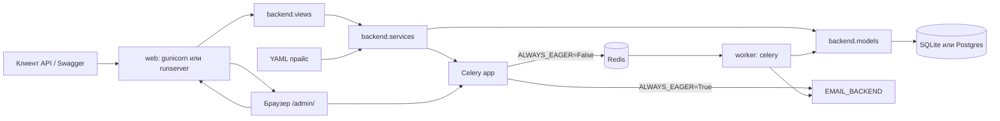
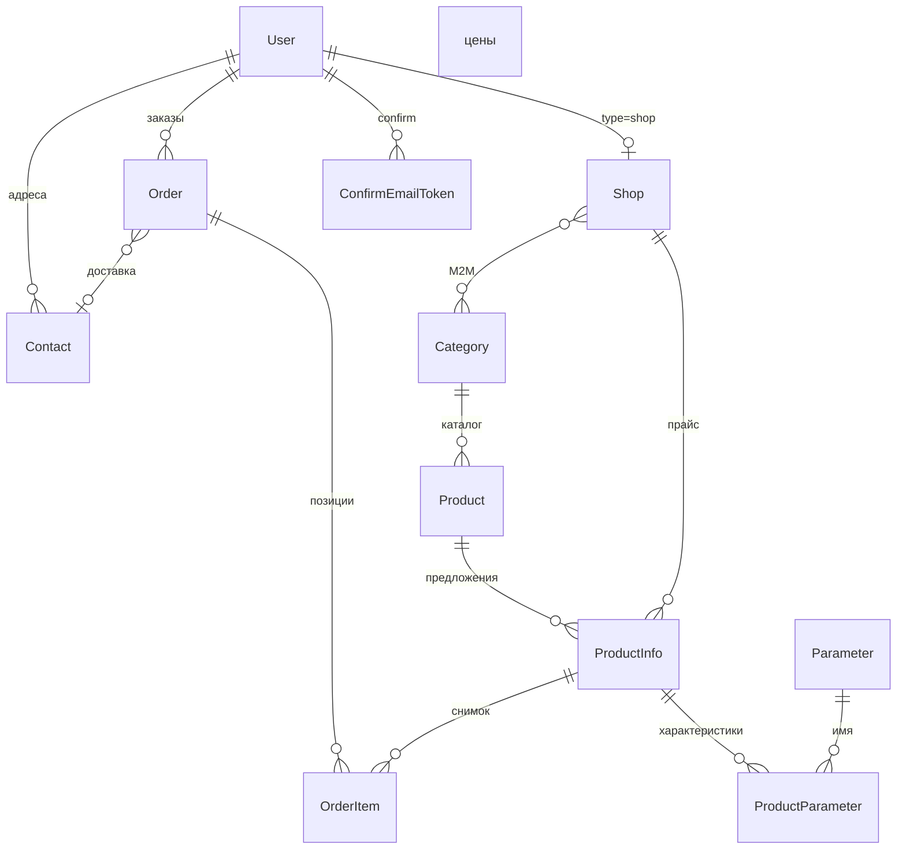

# Архитектура проекта

`python-final-diplom` — backend сервиса заказа товаров для розничной сети. Это не витрина с HTML-страницами, а REST API плюс Django Admin склада. Клиенты API — покупатель и поставщик; складской персонал работает в `/admin/`.

Документация по запуску: [README.md](README.md). Документация домена и эндпоинтов: [backend/README.md](backend/README.md). Этот файл описывает **как устроен код**: слои, папки, файлы, потоки данных и границы ответственности.

## 1. Стек и границы системы

| Слой | Технология | Роль в архитектуре |
| --- | --- | --- |
| HTTP API | Django 5 + Django REST Framework | маршруты `/api/v1/`, Token Authentication |
| Схема API | drf-spectacular | OpenAPI `/api/schema/`, Swagger `/api/docs/` |
| Админка | Django Admin | склад, прайсы, заказы |
| Домен | пакет `backend.services` | регистрация, корзина, заказ, импорт YAML |
| Очередь | Celery 5 + Redis | `send_email`, `do_import` |
| БД (локально) | SQLite | `DATABASE_URL=sqlite:///db.sqlite3` |
| БД (Docker) | PostgreSQL 16 | сервис `db`, volume `postgres_data` |
| Почта (разработка) | console backend | письма в stdout `runserver` / логов worker |
| HTTP-сервер (Docker) | gunicorn | `orders_service.wsgi:application` |
| Конфиг | `.env` + `python-dotenv` | секреты и переключение БД/Celery |

Что система **не** содержит: фронтенд, nginx, отдельный auth-сервис, брокер кроме Redis, отдельную БД для Celery results (Redis db 1).

## 2. Высокоуровневая схема



Два режима Celery — это не два кода, а один путь `send_email.delay()` / `do_import.delay()`:

- `CELERY_TASK_ALWAYS_EAGER=True` — задача выполняется в том же процессе Django;
- `False` — сообщение в Redis, исполняет контейнер/процесс `worker`.

## 3. Слои внутри backend

Запрос не должен содержать бизнес-правил в view. Цепочка фиксированная:

```
HTTP
  → orders_service.urls          префикс /api/v1/, /admin/, /api/docs/
    → backend.urls               конкретный path
      → backend.views.*          права, разбор request, JSON-ответ
        → backend.services.*     транзакции, проверки, письма, импорт
          → backend.models       ORM
```

| Слой | Можно | Нельзя |
| --- | --- | --- |
| `views/` | права, `serializer_class` для Swagger, вызов сервиса, `ok()` / `handle_service_error()` | писать в БД напрямую, слать почту, парсить YAML |
| `services/` | доменные инварианты, `transaction.atomic`, `ServiceError` | знать о `HttpRequest` сверх необходимости, рендерить HTML |
| `serializers.py` | валидация входа/выхода | создавать заказы и списывать остатки |
| `permissions.py` | проверка `type` / `is_staff` | бизнес-правила корзины |
| `tasks.py` | тонкая обёртка: `send_mail`, вызов importer | дублировать логику заказа |
| `admin.py` | складской UI; импорт ставит `do_import.delay` | обходить сервис смены статуса (письмо идёт через `notify_order_status_changed`) |

Ошибка домена — `backend.services.errors.ServiceError(message, status_code=400)`. View превращает её в `{"Status": false, "Errors": "..."}`.

Успешные мутации чаще отвечают `{"Status": true, ...}` (`backend.views.common.ok`). Списки каталога и детали заказа отдают тело сериализатора без этой обёртки.

## 4. Карта репозитория

```
python-final-diplom/
├── manage.py                 CLI Django (migrate, test, runserver, import_shop)
├── requirements.txt          зависимости Python
├── .env.example              шаблон секретов (коммитится)
├── .env                      локальные секреты (gitignore)
├── .gitignore
├── .dockerignore             venv, .git, .env, reference не попадают в образ
├── Dockerfile                образ web и worker, без migrate на сборке
├── docker-compose.yml        db, redis, web, worker
├── docker/
│   ├── web.sh                migrate + collectstatic + gunicorn
│   └── worker.sh             celery worker (migrate не вызывает)
├── architecture.md           этот файл
├── README.md                 запуск, Docker, сквозной curl-сценарий
├── data/                     учебные YAML-прайсы
│   ├── shop1.yaml            магазин «Связной»
│   └── shop2.yaml            магазин «М.Видео»
├── orders_service/           Django-проект (настройки, WSGI, Celery)
├── backend/                  единственное доменное приложение
└── reference/                материалы задания и эталон Нетологии (не runtime)
```

Во время работы также появляются (не в git): `venv/`, `db.sqlite3`, `media/`, `staticfiles/`.

## 5. Пакет `orders_service` — оболочка Django

Это **проект**, не домен. Здесь нет моделей заказа.

| Файл | За что отвечает |
| --- | --- |
| `__init__.py` | импортирует `celery_app`, чтобы worker и `manage.py` видели одно приложение Celery |
| `settings.py` | `SECRET_KEY`, `DEBUG`, `ALLOWED_HOSTS`, `CSRF_TRUSTED_ORIGINS`, разбор `DATABASE_URL`, `AUTH_USER_MODEL = 'backend.User'`, DRF, spectacular, почта, Celery; в тестах принудительно `CELERY_TASK_ALWAYS_EAGER=True` |
| `urls.py` | корень URL: `/admin/`, `/api/schema/`, `/api/docs/`, include `backend.urls` на `/api/v1/`; в `DEBUG` раздача `STATIC`/`MEDIA` |
| `wsgi.py` | точка входа gunicorn / `runserver` |
| `asgi.py` | ASGI (в compose не используется) |
| `celery.py` | `Celery('orders_service')`, конфиг из Django с префиксом `CELERY_`, `autodiscover_tasks()` находит `backend.tasks` |

### Настройки, которые меняют архитектуру

- `AUTH_USER_MODEL` задан **до первой миграции**. Пользователь живёт в `backend`, не в `django.contrib.auth.models.User`.
- `DATABASE_URL`: `sqlite:///` → SQLite; иначе Postgres (`psycopg`).
- `CELERY_BROKER_URL` / `CELERY_RESULT_BACKEND` — Redis; в Docker compose **перебивает** значения из `.env` на хосты `db` и `redis`.
- `STATIC_ROOT` / `MEDIA_ROOT` — collectstatic и загрузки прайса (`media/imports/`).
- `ADMIN_EMAIL` — получатель «накладной» при оформлении заказа.

Секреты не хардкодятся: без `SECRET_KEY` процесс не стартует.

## 6. Приложение `backend` — домен

`INSTALLED_APPS` → `backend.apps.BackendConfig`. В `ready()` подключаются `signals`.

### 6.1. Корень приложения

| Файл | Ответственность |
| --- | --- |
| `apps.py` | конфиг приложения, импорт сигналов |
| `models.py` | вся предметная область (см. §7) |
| `serializers.py` | контракт API: регистрация, логин, контакт, каталог, заказ, смена статуса |
| `permissions.py` | `IsBuyer`, `IsShopUser`, `IsShopOrStaff` |
| `urls.py` | таблица маршрутов `/api/v1/*` |
| `admin.py` | регистрация моделей, импорт прайса, фильтр заказов по магазину, письмо при смене статуса |
| `forms.py` | `PriceImportForm`: YAML-файл **или** URL |
| `tasks.py` | Celery-задачи `send_email`, `do_import` |
| `signals.py` | `reset_password_token_created` → письмо с токеном сброса |
| `README.md` | пользовательская документация API и сценариев |

### 6.2. `backend/views/` — HTTP-адаптер

Тонкие `APIView` / `ListAPIView`. Пакетный `__init__.py` реэкспортирует классы для `backend.urls`.

| Файл | Эндпоинты | Задача слоя |
| --- | --- | --- |
| `common.py` | — | `ok`, `fail`, `handle_service_error` |
| `accounts.py` | register, confirm, login, details, contact | делегирует в `services.accounts` |
| `catalog.py` | categories, shops, products | queryset + сериализаторы, без сервиса (чтение витрины) |
| `basket.py` | `/basket` GET/POST/PUT/DELETE | только `IsBuyer` → `services.basket` |
| `orders.py` | `/order`, `/order/<id>/`, `/order/<id>/status` | confirm / list / patch статуса |
| `partners.py` | update, state, orders, export | shop-only; export отдаёт `HttpResponse` YAML, не JSON |

Каталог нарочно публичный (`AllowAny`): витрина без логина. Запись в корзину и контакты — только `buyer`. Прайс и витрина — только `shop`. Смена статуса — `shop` или `staff`.

### 6.3. `backend/services/` — доменные сценарии

| Файл | Сценарии |
| --- | --- |
| `__init__.py` | реэкспорт функций импорта YAML |
| `errors.py` | `ServiceError` |
| `email.py` | единственная точка постановки письма: `send_email.delay` |
| `accounts.py` | регистрация (`type=buyer`, `is_active=False`, токен confirm), confirm, login → DRF Token, профиль, контакты (лимит 5) |
| `basket.py` | корзина = `Order(state=basket)`; add/update/delete позиций; снимок `price`; проверка витрины и остатка |
| `orders.py` | оформление: lock остатков, `state=new`, письма клиенту и `ADMIN_EMAIL`; смена статуса; список заказов партнёра; `notify_order_status_changed` общее для API и admin |
| `importer.py` | скачать/прочитать YAML, валидация схемы, upsert магазина/категорий/товаров/предложений, удаление или обнуление устаревших предложений |
| `partners.py` | `get_shop` / `set_shop_state`; `export_price_list` — словарь того же формата, что импорт |

Импорт — **upsert**, не «удалить каталог и залить заново». Если старое предложение уже есть в `OrderItem`, строка не удаляется: `quantity=0`.

### 6.4. `backend/management/commands/`

| Файл | Назначение |
| --- | --- |
| `import_shop.py` | `python manage.py import_shop <yaml> --email <shop@...>`: создаёт пользователя `type=shop`, если нет, грузит файл через importer |

Нужна для локального и Docker-наполнения витрины без HTTP.

### 6.5. `backend/templates/admin/backend/shop/`

| Файл | Назначение |
| --- | --- |
| `change_form.html` | кнопка «Импортировать прайс» на карточке магазина |
| `import_price.html` | страница формы файла/URL |

Шаблонный слой есть только у админки. У API HTML нет (кроме debug-страницы Django при `DEBUG=True`).

### 6.6. `backend/migrations/`

| Файл | Содержание |
| --- | --- |
| `0001_initial.py` | кастомный `User` (email, без username) — обязателен на этапе 1, до остальных таблиц |
| `0002_...py` | Shop, Category, Product, ProductInfo, параметры, Contact, Order, OrderItem, ConfirmEmailToken |

Миграции коммитятся. Сборка Docker их **не выполняет**; это делает `docker/web.sh` при старте контейнера, когда Postgres уже healthy.

### 6.7. `backend/tests/`

Тесты на `APITestCase`, БД — SQLite in-memory. Celery в тестах eager.

| Файл | Архитектурный контракт, который фиксирует |
| --- | --- |
| `test_auth.py` | регистрация шлёт письмо, confirm включает login |
| `test_import.py` | два YAML, два магазина, повторный импорт = update |
| `test_export.py` | экспорт → тот же формат → повторный import |
| `test_permissions.py` | buyer ≠ partner API; аноним ≠ корзина |
| `test_scenario.py` | сквозной зачёт: две витрины, заказ, письма, `state=false` |
| `test_admin.py` | цена позиции в админке, письмо статуса, изоляция заказов магазина, импорт |
| `test_tasks.py` | обе Celery-задачи вызываются и делают работу |

## 7. Предметная модель

Центральная идея: **товар общий, цена и остаток — у магазина**.



| Сущность | Смысл в архитектуре |
| --- | --- |
| `User` | логин по email; `type` разделяет API; `is_active` после confirm |
| `Shop` | витрина поставщика; `state` рубит приём заказов и выдачу в `/products` |
| `Category` / `Product` | общий справочник |
| `ProductInfo` | офер магазина; `external_id` = `id` из YAML; в корзину кладётся **внутренний** `ProductInfo.id` |
| `Order` со `state=basket` | корзина, одна на пользователя |
| `Order` с другим `state` | заказ; корзина в списках заказов не показывается |
| `OrderItem.price` | снимок на момент добавления; прайс больше не переписывает историю. В админке поле readonly, `save()` подставляет цену офера |
| `ConfirmEmailToken` | одноразовый ключ регистрации |

Статусы: `basket` → `new` → `confirmed` → `assembled` → `sent` → `delivered`, плюс `canceled`. Через PATCH статуса `basket` выставить нельзя.

## 8. Потоки данных

### 8.1. Регистрация и вход

```
POST /user/register
  accounts.register_user
    User(is_active=False, type=buyer)
    ConfirmEmailToken
    send_notification → send_email.delay
POST /user/register/confirm  → is_active=True, токен удаляется
POST /user/login             → rest_framework.authtoken.Token
```

Все защищённые методы ждут заголовок `Authorization: Token <key>`.

Сброс пароля — стороннее приложение `django_rest_passwordreset`; сигнал в `backend/signals.py` только отправляет ключ письмом.

### 8.2. Импорт прайса

Три входа, один importer:

```
import_shop (CLI)
POST /partner/update {url}
Admin form file|url
        \         |          /
         do_import.delay  (админка и очередь)
         или прямой вызов importer (CLI, partner/update)
                 ↓
    import_price_list_from_path | _from_url | _from_yaml
                 ↓
           upsert Shop / Category / Product / ProductInfo / parameters
```

Файл из админки нельзя сериализовать в Celery как upload: он сохраняется в `MEDIA_ROOT/imports/{shop_id}_{filename}`, в задачу уходит `path`. Поэтому в Docker у `web` и `worker` общий volume `media_data`.

Экспорт — обратная проекция ORM → dict → `yaml.safe_dump`, маршрут `GET /partner/export`.

### 8.3. Корзина и заказ

```
GET/POST /basket     Order(basket) + OrderItem (price snapshot)
POST /order {id, contact}
  select_for_update позиций и ProductInfo
  проверка shop.state и quantity
  quantity -= n
  state = new, contact привязан
  письма: клиент «принят», ADMIN_EMAIL «накладная»
PATCH /order/<id>/status {state}
  shop видит только заказы со своими оферами
  staff — любой заказ
  notify_order_status_changed → одно письмо клиенту
```

Каталог `GET /products` фильтрует `shop__state=True`. Выключенная витрина исчезает из выдачи и блокирует add-to-basket / confirm.

## 9. Админка как второй UI того же домена

`/admin/` — не отдельное приложение, а второй адаптер к тем же моделям и сервисам.

- суперпользователь видит всё;
- пользователь `type=shop` с `is_staff` (не superuser) ограничен queryset'ами своего магазина и заказов без корзин;
- смена статуса заказа вызывает **тот же** `notify_order_status_changed`, что API;
- импорт — Celery `do_import`, не синхронный вызов в request, если `ALWAYS_EAGER=False`.

Это сознательное решение этапа 6–7: склад и API не расходятся по письмам и прайсу.

## 10. Фоновые задачи

`orders_service/__init__.py` гарантирует, что `celery -A orders_service` подхватывает Django.

| Задача | Аргументы | Побочный эффект |
| --- | --- | --- |
| `backend.tasks.send_email` | subject, message, recipients | `django.core.mail.send_mail` |
| `backend.tasks.do_import` | user_id, url xor path | importer, пишет каталог |

Писать `send_mail` из сервисов напрямую нельзя: иначе eager/worker и админка/API разъедутся. Все уведомления идут в `services.email.send_notification`.

`kombu` зафиксирован `<5.4`, чтобы Redis-транспорт совпадал с `redis~=5.0` (более новый kombu требует redis-py 6). Это ограничение слоя очереди, не домена.

## 11. Конфигурация окружений

| Режим | Процессы | БД | Очередь |
| --- | --- | --- | --- |
| Локальная сдача | `runserver` | SQLite | eager, Redis не обязателен |
| Локально «как прод» | `runserver` + `celery worker` + `docker compose up redis` | SQLite или Postgres на localhost | Redis |
| Docker Compose | `web`, `worker`, `db`, `redis` | Postgres volume | Redis, eager выключен compose'ом |

Compose **намеренно** переопределяет `DATABASE_URL` и брокер: в `.env` для venv может остаться SQLite и `ALWAYS_EAGER=True`, а контейнеры всё равно ходят на `db`/`redis`. Пароли Postgres берутся из `.env` (`POSTGRES_*`).

Скрипты:

- `docker/web.sh` — единственное место migrate в контейнерах (после healthy Postgres);
- `docker/worker.sh` — только worker, ждёт `web` healthy, чтобы не гоняться с migrate.

`Dockerfile` не вызывает `migrate`: на сборке нет БД (это ломает эталонный Dockerfile аналога).

`.dockerignore` исключает `venv`, `.env`, `reference`, markdown, sqlite, media — образ содержит код приложения, `data/*.yaml` и зависимости.

## 12. Внешние пакеты и зачем они в архитектуре

| Пакет | Место в системе |
| --- | --- |
| Django | ORM, admin, auth, management commands |
| djangorestframework | APIView, Token, сериализаторы |
| drf-spectacular | живая схема из тех же view |
| celery + kombu + redis | очередь писем и импорта |
| pyyaml | импорт/экспорт прайса |
| requests | скачивание YAML по URL |
| psycopg | драйвер Postgres |
| python-dotenv | загрузка `.env` в settings |
| django-rest-passwordreset | готовые view сброса пароля + сигнал |
| gunicorn | WSGI в Docker |
| pytest-django | в requirements для совместимости; прогон диплома — `manage.py test` |

`ujson` в зависимостях задания; горячий путь JSON идёт через стандартный DRF JSONRenderer.

## 13. Что лежит в `reference/` и почему это не слой приложения

| Путь | Смысл |
| --- | --- |
| `reference/step-*.md` | формулировки этапов диплома |
| `reference/api.md`, `service.md`, `screens.md` | ТЗ по API и экранам |
| `reference/netology_pd_diplom/` | учебный эталон (монолитный `backend/views.py`, сигналы, другой settings-пакет `netology_pd_diplom`) |

Рабочий код **не** `import`ит этот каталог. Архитектура этого репозитория другая: views разбиты по контекстам, домен вынесен в `services/`, пользователь свой с этапа 1, импорт — upsert, Docker не мигрирует на build.

## 14. Инварианты, которые нельзя нарушать при доработках

1. `AUTH_USER_MODEL` остаётся `backend.User`; логин — email.
2. View не обходят `services` для записи (корзина, заказ, импорт, письма).
3. Цена в `OrderItem` — снимок; пересчёт из текущего прайса запрещён.
4. Письма только через `send_notification` / `send_email.delay`.
5. Смена статуса в admin и API — одна функция уведомления.
6. Импорт YAML — upsert; история заказов важнее чистоты витрины.
7. Файл импорта из admin попадает в worker по общему `media`.
8. В Docker migrate только у `web`, не в Dockerfile.
9. Секреты в `.env`, не в git; `.env.example` — контракт переменных.
10. Каталог читается без токена; мутации покупателя и поставщика закрыты ролями.

## 15. Куда смотреть при изменении фичи

| Хочу изменить | Файлы |
| --- | --- |
| Новый REST-маршрут | `backend/urls.py`, view в соответствующем модуле `views/`, при записи — `services/` |
| Правило корзины/остатков | `backend/services/basket.py`, `orders.py` |
| Поля JSON | `backend/serializers.py` |
| Кто имеет доступ | `backend/permissions.py` + `permission_classes` view |
| Формат YAML | `importer.py` + `partners.export_price_list` + `data/*.yaml` + тесты import/export |
| Письмо | `services/email.py` и место вызова в accounts/orders/signals; шаблонов писем нет (plain text) |
| Админка | `admin.py`, шаблоны shop, `forms.py` |
| Настройка БД/очереди | `orders_service/settings.py`, `.env.example`, `docker-compose.yml` |
| Сквозной сценарий зачёта | `backend/tests/test_scenario.py` |
