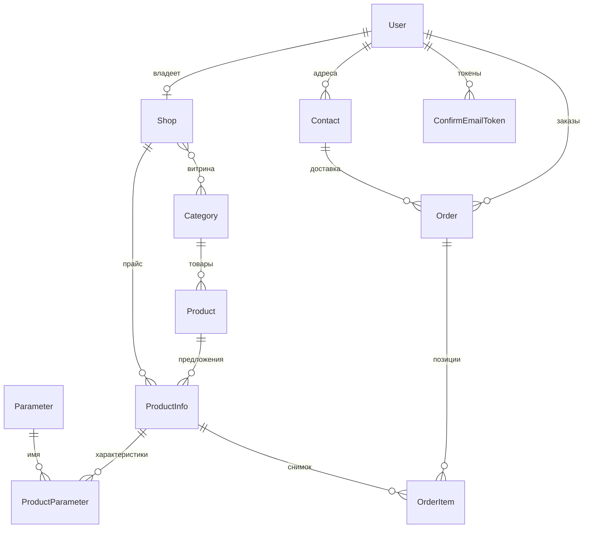

# Backend: сервис заказа товаров

Django-приложение `backend` — REST API закупок для розничной сети. Покупатель собирает корзину из предложений нескольких магазинов и оформляет заказ. Поставщик загружает YAML-прайс, включает или выключает витрину и видит свои заказы. Склад работает через Django Admin.

Запуск проекта, Docker и переменные окружения описаны в [корневом README](../README.md). Интерактивная схема: [http://127.0.0.1:8000/api/docs/](http://127.0.0.1:8000/api/docs/). Базовый префикс API: `/api/v1/`.

## Возможности

- регистрация покупателя по email, подтверждение токеном из письма, вход по Token Authentication;
- каталог предложений магазинов с фильтрами по магазину и категории;
- корзина (`Order` со статусом `basket`) с позициями из разных магазинов;
- оформление заказа: снимок цены, списание остатка, письма клиенту и на `ADMIN_EMAIL`;
- смена статуса заказа поставщиком или сотрудником — то же письмо, что и из админки;
- импорт YAML-прайса (upsert) из API, админки и management-команды;
- экспорт каталога магазина `GET /api/v1/partner/export` в том же YAML-формате;
- фоновые задачи Celery: `send_email`, `do_import`.

## Роли

| Тип | Как появляется | Что может |
| --- | --- | --- |
| `buyer` | `POST /user/register` | контакты, корзина, свои заказы |
| `shop` | админка или `import_shop` | прайс, витрина, заказы своего магазина, экспорт YAML |
| сотрудник (`is_staff`) | `createsuperuser` или админка | админка склада, смена статуса любого заказа |

Регистрация через API всегда создаёт покупателя (`type=buyer`, `is_active=False`) и шлёт письмо «Подтверждение регистрации» с токеном. Пока email не подтверждён, логин не проходит.

Авторизация API: заголовок `Authorization: Token <ключ>`. Ключ возвращает `POST /user/login` в поле `Token`.

Права в коде: `IsBuyer`, `IsShopUser`, `IsShopOrStaff` (`backend/permissions.py`).

## Структура приложения

```
backend/
  models.py              модели и статусы заказа
  serializers.py         DRF-сериализаторы
  permissions.py         роли API
  urls.py                маршруты /api/v1/
  admin.py               админка склада
  forms.py               форма импорта прайса
  tasks.py               Celery: send_email, do_import
  signals.py             письмо при сбросе пароля
  views/                 тонкие APIView, без бизнес-логики
    accounts.py          регистрация, логин, профиль, контакты
    catalog.py           категории, магазины, товары
    basket.py            корзина
    orders.py            заказы и смена статуса
    partners.py          прайс, витрина, заказы магазина, экспорт
    common.py            ответы {Status, Errors}
  services/              доменная логика
    accounts.py
    basket.py
    orders.py
    partners.py          витрина и экспорт YAML
    importer.py          разбор и upsert прайса
    email.py             send_email.delay(...)
    errors.py            ServiceError
  management/commands/import_shop.py
  tests/                 auth, import, export, permissions, scenario, admin, tasks
  templates/admin/backend/shop/   страница импорта прайса
```

Проект Django: `orders_service`. Пользователь задан до первой миграции: `AUTH_USER_MODEL = 'backend.User'`.

## Модели

Вход по email, поля `username` нет.



| Модель | Назначение |
| --- | --- |
| `User` | email, `type` (`buyer` / `shop`), `company`, `position`, `is_active` |
| `Shop` | магазин поставщика; `state=False` — витрина выключена, заказы не принимаются |
| `Category` | категория; M2M с магазинами, которые её продают |
| `Product` | товар в общем каталоге (имя + категория), без цены |
| `ProductInfo` | предложение магазина: `external_id` из YAML, цена, РРЦ, остаток |
| `Parameter` / `ProductParameter` | характеристики предложения (диагональ, цвет, …) |
| `Contact` | адрес доставки покупателя, не больше 5 на пользователя |
| `Order` | корзина или заказ; сумма `total_sum` = Σ(price × quantity) |
| `OrderItem` | позиция; `price` копируется с `ProductInfo` и больше не меняется с прайсом |
| `ConfirmEmailToken` | одноразовый ключ подтверждения регистрации |

Ограничения уникальности: `(product, shop, external_id)` у предложения, `(order, product_info)` у позиции, `(product_info, parameter)` у характеристики.

### Статусы заказа

`basket` → `new` → `confirmed` → `assembled` → `sent` → `delivered`. Отмена: `canceled`.  
`basket` — служебный статус корзины, через API смены статуса его выставить нельзя.

## YAML-прайс

Один файл — один магазин. Категории и товары создаются или обновляются (upsert). Предложения, которых больше нет в файле, удаляются; если на них уже есть позиции заказов, остаток обнуляется, чтобы не ломать историю.

Обязательные поля корня: `shop`, `categories`, `goods`.  
У категории: `id`, `name`.  
У товара: `id`, `category`, `name`, `price`, `price_rrc`, `quantity`. Необязательно: `model`, `parameters`.

```yaml
shop: Связной
categories:
  - id: 224
    name: Смартфоны
goods:
  - id: 4216292
    category: 224
    model: apple/iphone/xs-max
    name: Смартфон Apple iPhone XS Max 512GB (золотистый)
    price: 110000
    price_rrc: 116990
    quantity: 14
    parameters:
      "Диагональ (дюйм)": 6.5
      "Цвет": золотистый
```

Примеры в репозитории: `data/shop1.yaml` (Связной), `data/shop2.yaml` (М.Видео). Для корзины из двух магазинов нужны оба.

`id` товара в YAML попадает в `ProductInfo.external_id`. В корзину кладётся внутренний `id` предложения (`ProductInfo.id` из `GET /products`), не YAML-id.

Импорт доступен только пользователю `type=shop`. Если магазина ещё нет, он создаётся и привязывается к этому пользователю.

## Как загрузить прайс

1. Команда (создаёт shop-пользователя, если его нет):

   ```bash
   python manage.py import_shop data/shop1.yaml --email shop@example.com
   python manage.py changepassword shop@example.com
   ```

2. API поставщика: `POST /api/v1/partner/update` с `{"url": "https://.../price.yaml"}`. URL сохраняется у магазина.

3. Админка: карточка магазина → «Импортировать прайс» → файл или URL. Файл пишется в `media/imports/`, задача `do_import` читает путь (байты загрузки в Celery не передаются).

4. Список магазинов в админке: действие «Импортировать прайс» — только если у магазина уже заполнен URL.

5. Экспорт: `GET /api/v1/partner/export` (токен магазина) → YAML того же формата. Его можно снова импортировать.

## REST API

Успех обычно `{"Status": true, ...}`. Ошибка: `{"Status": false, "Errors": "..."}` и код 400/403/404. Каталог и детали заказа отдают объекты сериализаторов без обёртки `Status`.

Все пути ниже относительно `/api/v1`.

### Покупатель

| Метод | Путь | Доступ | Тело / параметры |
| --- | --- | --- | --- |
| POST | `/user/register` | аноним | `first_name`, `last_name`, `email`, `password`; опционально `company`, `position` |
| POST | `/user/register/confirm` | аноним | `email`, `token` из письма |
| POST | `/user/login` | аноним | `email`, `password` → `Token` |
| GET | `/user/details` | любой авторизованный | профиль |
| POST | `/user/details` | любой авторизованный | частичное обновление; смена `password` сбрасывает токен |
| POST | `/user/password_reset` | аноним | `email` — токен приходит письмом |
| POST | `/user/password_reset/confirm` | аноним | токен и новый пароль (`django-rest-passwordreset`) |
| GET/POST/PUT/DELETE | `/user/contact` | buyer | адрес: `city`, `street`, `phone`; дом/корпус/квартира необязательны. PUT/DELETE — поле `id` |
| GET | `/basket` | buyer | текущая корзина (создаётся при первом обращении) |
| POST | `/basket` | buyer | `{"product_info": 1, "quantity": 1}` или `{"items":[...]}` |
| PUT | `/basket` | buyer | `{"id": <id позиции>, "quantity": 2}` |
| DELETE | `/basket` | buyer | `{"id": "1,2"}` или `{"items":[1,2]}` |
| POST | `/order` | buyer | `{"id": <id корзины>, "contact": <id контакта>}` |
| GET | `/order` | buyer | заказы без корзины |
| GET | `/order/<id>/` | buyer | один заказ |

Пароль проверяется валидаторами Django (слишком короткий или простой не пройдёт).

### Каталог (без авторизации)

| Метод | Путь | Что возвращает |
| --- | --- | --- |
| GET | `/categories` | все категории |
| GET | `/shops` | магазины с `state=true` |
| GET | `/products` | предложения магазинов с открытой витриной |
| GET | `/products?shop_id=1` | фильтр по магазину |
| GET | `/products?category_id=224` | фильтр по категории |
| GET | `/products/<id>/` | одно предложение |

В ответе товара: `id`, `model`, `product`, `shop`, `quantity`, `price`, `price_rrc`, `product_parameters`.

### Поставщик

| Метод | Путь | Действие |
| --- | --- | --- |
| POST | `/partner/update` | импорт по `url` |
| GET | `/partner/state` | текущая витрина |
| POST | `/partner/state` | `{"state": false}` / `true` — выключить / включить приём заказов |
| GET | `/partner/orders` | заказы, где есть позиции этого магазина |
| GET | `/partner/export` | скачать YAML-прайс (`Content-Type: application/x-yaml`) |
| PATCH | `/order/<id>/status` | `{"state": "confirmed"}` — также доступно staff |

Покупатель на `/partner/*` получает 403. Аноним на корзину — 401.

## Сценарий заказа

1. Зарегистрировать покупателя, взять токен из письма в терминале `runserver` (или в логах `worker` в Docker), подтвердить email, залогиниться.
2. Загрузить прайсы двух магазинов.
3. `GET /products` — запомнить `id` предложений из разных `shop`.
4. Создать контакт.
5. Положить в корзину два `product_info`.
6. `POST /order` с `id` корзины и `contact`.

При оформлении:

- заказ должен быть в статусе `basket` и принадлежать пользователю;
- корзина не пустая;
- каждый магазин с `state=true`;
- остатка хватает; количество списывается атомарно;
- статус становится `new`, к заказу пишется контакт;
- клиенту уходит «Заказ №N принят», на `ADMIN_EMAIL` — «Накладная заказа №N».

Дальше поставщик меняет статус (`confirmed`, `assembled`, …). Клиенту уходит письмо «Статус заказа №N изменён» — и из API, и из админки вызывается одна функция `notify_order_status_changed`.

## Админка склада

URL: `/admin/`. Заголовок: «Админка склада».

- Пользователи: вход по email, поле `type`.
- Магазины: галочка витрины, URL прайса, кнопка импорта, action «Импортировать прайс».
- Категории, товары, предложения, характеристики.
- Заказы: фильтр по магазину и статусу, inline позиций. Поле `price` у позиции только для чтения: при сохранении подставляется цена `ProductInfo` (иначе NOT NULL в БД).
- Сотрудник магазина (`type=shop`, не суперпользователь) в списках видит только свой магазин и заказы со своими товарами, без корзин.

Смена статуса заказа в карточке отправляет то же письмо, что `PATCH /order/<id>/status`.

## Celery

Задачи в `backend/tasks.py`. Все письма идут через `backend.services.email.send_notification` → `send_email.delay(...)`. Импорт из админки — `do_import.delay(user_id, url=...)` или `path=...`.

| `CELERY_TASK_ALWAYS_EAGER` | Поведение |
| --- | --- |
| `True` (локальный `.env` по умолчанию) | задача выполняется в процессе Django, Redis не нужен, письмо печатается в терминале `runserver` |
| `False` | нужен Redis и `celery -A orders_service worker -l info`; в Docker это уже настроено |

В тестах eager всегда включён (`'test' in sys.argv`).

Письма:

- подтверждение регистрации;
- сброс пароля (`signals.py` + `django-rest-passwordreset`);
- заказ принят (клиент);
- накладная (`ADMIN_EMAIL`);
- смена статуса (клиент).

Бэкенд почты по умолчанию — консоль (`EMAIL_BACKEND=django.core.mail.backends.console.EmailBackend`).

## Тесты

```bash
python manage.py test backend.tests
```

| Модуль | Что проверяет |
| --- | --- |
| `test_auth` | регистрация → письмо → confirm → login |
| `test_import` | upsert `shop1.yaml` / `shop2.yaml` |
| `test_export` | YAML экспорта снова импортируется; buyer получает 403 |
| `test_permissions` | buyer не ходит в partner API; аноним не открывает корзину |
| `test_scenario` | два магазина, заказ, письма, выключение витрины |
| `test_admin` | импорт из админки, цена позиции, письмо при смене статуса, изоляция заказов магазина |
| `test_tasks` | `send_email` в outbox, `do_import` с диска |

## Типичные ответы API

| Ситуация | Что происходит |
| --- | --- |
| email уже занят | ошибка сериализатора при регистрации |
| слабый пароль | Django password validators |
| неподтверждённый email | «Пользователь не активен. Подтвердите email.» |
| магазин выключен | нельзя положить в корзину и нельзя оформить заказ с его товаром |
| остатка не хватает | текст с текущим `quantity` |
| импорт не-shop пользователем | «Импорт прайса доступен только пользователю типа shop.» |
| экспорт без магазина | «Магазин ещё не создан. Сначала загрузите прайс.» |

## Связанные файлы вне `backend/`

- `orders_service/settings.py` — БД, Celery, почта, `AUTH_USER_MODEL`;
- `orders_service/celery.py` — приложение Celery;
- `data/*.yaml` — учебные прайсы;
- `docker-compose.yml` — `web`, `db`, `redis`, `worker`.
