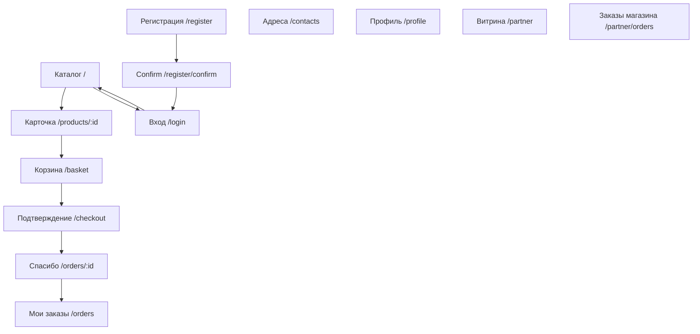

# Бриф: фронтенд к `orders_service`

Реализация SPA лежит в каталоге `frontend/` (Angular 20, FSD, PrimeNG). Этот файл — бриф и правила слоёв.

Бэкенд уже готов: Django + DRF, см. [backend/README.md](backend/README.md), [architecture.md](architecture.md), Swagger `/api/docs/`. Фронтенд — отдельный клиент к существующему API, без копирования HTML-магазина и без замены Django Admin.

## 1. Стек (зафиксирован)

| Решение | Версия / выбор | Зачем |
| --- | --- | --- |
| Angular | **20**, standalone, application builder | актуальный SPA |
| Архитектура | **Feature-Sliced Design** | слои и слайсы, а не «папка components» |
| UI | **PrimeNG** той же мажорной линии, что Angular 20 (PrimeNG 20 + Aura / `@primeuix/themes`) | таблицы, формы, тосты, диалоги |
| Иконки | PrimeIcons | единый набор с PrimeNG |
| Состояние | сигналы Angular (`signal` / `computed` / `resource` при необходимости) | без NgRx в первой версии |
| HTTP | `HttpClient` + interceptors | Token DRF, разбор ошибок |
| Dev-прокси | `proxy.conf.json` → `http://127.0.0.1:8000` | CORS на бэкенде не обязателен |

Запрещено без отдельного решения: NgModules как основа приложения, Material вместо PrimeNG, Vue/React, JWT вместо DRF Token, свой CSS-фреймворк поверх PrimeNG.

Категория приложения в FSD: **SPA витрины и кабинетов** над REST, не SSR и не микрофронты.

## 2. Что строим и чего не строим

**Строим** SPA в каталоге `frontend/` (сосед `backend/` и `orders_service/`).

**Роли UI:**

- гость: каталог, карточка предложения, вход, регистрация, confirm email, сброс пароля;
- `buyer`: корзина, контакты, оформление, история заказов, профиль;
- `shop`: витрина вкл/выкл, импорт прайса по URL, экспорт YAML, заказы магазина, смена статуса.

**Не строим:**

- складскую админку (`/admin/` остаётся Django);
- загрузку YAML-файла с диска (бэкенд-API импорта принимает `url`; файл — только admin);
- вложенные категории, поиск full-text (в API есть `shop_id` и `category_id`);
- чат, платежи, карты;
- отдельный BFF.

Письма по-прежнему печатаются в консоли Django / логах worker. На экране confirm и reset пользователь **вручную** вставляет токен из письма.

## 3. Пользовательские сценарии (экраны)

Соответствуют [reference/service.md](reference/service.md) и текущему API.



Порядок заказа: фильтры каталога → предложение (магазин + цена) → количество → корзина (несколько магазинов) → выбор контакта → подтверждение → «спасибо» + номер заказа.

## 4. Feature-Sliced Design: слои

Корень фронтенда:

```
frontend/
  src/
    app/                 # слой app: bootstrap, routes, providers, layout
    pages/               # слой pages: одна страница = один маршрут
    widgets/             # слой widgets: блоки страницы из нескольких фич/сущностей
    features/            # слой features: одно действие пользователя
    entities/            # слой entities: сущности бэкенда
    shared/              # слой shared: UI PrimeNG-обёртки, API-клиент, конфиг, lib
```

Правило импортов (сверху вниз, нарушения — ошибка ревью):

```
app     → pages, widgets, features, entities, shared
pages   → widgets, features, entities, shared
widgets → features, entities, shared
features→ entities, shared
entities→ shared
shared  → только shared
```

Слайс внутри слоя: `ui/` (компоненты), `model/` (сигналы, типы, мапперы), `api/` (вызовы HTTP). Публичный вход слайса — `index.ts`, внутренние файлы снаружи не импортировать.

Страница **не** ходит в `HttpClient` напрямую и **не** знает URL бэкенда. Виджет не содержит роутер-outlet бизнес-логики заказа целиком — только композицию.

## 5. Слайсы под этот бэкенд

### `app/`

- `app.config.ts` — `provideHttpClient`, interceptors, PrimeNG theme (Aura), `provideRouter`.
- `app.routes.ts` — lazy `loadComponent` на каждую page.
- `layout/` — `ShellLayout` (menubar, корзина-бейдж, роль), `AuthLayout` (логин/регистрация).
- guards: `authGuard`, `guestGuard`, `buyerGuard`, `shopGuard`.

### `pages/` — маршруты

| Слайс | URL | Кто | Сборка из |
| --- | --- | --- | --- |
| `catalog` | `/` | все | виджет фильтров + сетка, фича add-to-basket |
| `product` | `/products/:id` | все | entity card + add-to-basket |
| `login` | `/login` | гость | feature auth-login |
| `register` | `/register` | гость | feature auth-register |
| `register-confirm` | `/register/confirm` | гость | feature auth-confirm |
| `password-reset` | `/password-reset` | гость | feature auth-reset |
| `basket` | `/basket` | buyer | виджет корзины |
| `checkout` | `/checkout` | buyer | выбор контакта + confirm order |
| `order-success` | `/orders/:id` | buyer | entity order + «спасибо» |
| `orders` | `/orders` | buyer | таблица заказов |
| `contacts` | `/contacts` | buyer | CRUD адресов |
| `profile` | `/profile` | auth | редактирование профиля |
| `partner-dashboard` | `/partner` | shop | state витрины + import URL + export |
| `partner-orders` | `/partner/orders` | shop | заказы + смена статуса |
| `forbidden` / `not-found` | `/403`, `/**` | все | shared ui |

### `widgets/`

| Слайс | Состав |
| --- | --- |
| `header` | логотип, меню по роли, бейдж корзины, выход |
| `product-filters` | категории + магазины (entity) → query params |
| `product-grid` | список `ProductInfo` |
| `basket-panel` | позиции, сумма, переход к checkout |
| `checkout-summary` | корзина + выбранный контакт |
| `partner-toolbar` | тумблер витрины + кнопки импорта/экспорта |

### `features/` — одно действие = один слайс

| Слайс | API |
| --- | --- |
| `auth-login` | `POST /user/login` |
| `auth-register` | `POST /user/register` |
| `auth-confirm` | `POST /user/register/confirm` |
| `auth-logout` | локально сбросить token |
| `auth-password-reset` | `/user/password_reset` + confirm |
| `add-to-basket` | `POST /basket` `{product_info, quantity}` |
| `update-basket-item` | `PUT /basket` |
| `remove-basket-item` | `DELETE /basket` |
| `place-order` | `POST /order` `{id, contact}` |
| `save-contact` | POST/PUT/DELETE `/user/contact` |
| `update-profile` | `POST /user/details` |
| `toggle-shop-state` | `POST /partner/state` |
| `import-price-url` | `POST /partner/update` `{url}` |
| `export-price` | `GET /partner/export` blob YAML |
| `change-order-status` | `PATCH /order/:id/status` |

### `entities/` — зеркало сериализаторов бэкенда

| Слайс | Поля с API (не выдумывать) |
| --- | --- |
| `session` | token, `User.type`, загрузка `/user/details` |
| `user` | id, names, email, company, position, type |
| `product-info` | id, model, product, shop, quantity, price, price_rrc, product_parameters |
| `category` | id, name |
| `shop` | id, name, state |
| `basket` | Order со `state=basket`, ordered_items, total_sum |
| `order` | id, state, dt, total_sum, contact, ordered_items |
| `contact` | city, street, house, structure, building, apartment, phone |

Типы TypeScript повторяют JSON бэкенда (`snake_case` как в API **или** маппер в `camelCase` на границе `api/` — выбрать один стиль и не смешивать). В корзину кладётся **`ProductInfo.id`**, не YAML `external_id`.

### `shared/`

| Слайс | Содержание |
| --- | --- |
| `api` | `API_BASE='/api/v1'`, `authInterceptor` (`Authorization: Token …`), `errorInterceptor`, разбор `{Status, Errors}` |
| `config` | environment, proxy |
| `ui` | тонкие обёртки PrimeNG: page-header, empty-state, confirm-dialog host, toast host — **не** дублировать весь PrimeNG |
| `lib` | formatMoney, orderStatusLabel (русские лейблы статусов бэкенда) |
| `routes` | path constants |

Ошибки API: `Errors` бывает строкой или объектом полей сериализатора (регистрация). Интерцептор/хелпер приводит это к списку сообщений для `p-toast` / `p-message`.

## 6. Декомпозиция компонентов по слоям (пример)

Каталог — эталон, остальные страницы тем же принципом.

```
pages/catalog/ui/catalog-page.ts
  widgets/product-filters/ui/product-filters.ts
    entities/category + entities/shop   (загрузка списков)
  widgets/product-grid/ui/product-grid.ts
    entities/product-info/ui/product-info-card.ts
    features/add-to-basket/ui/add-to-basket-button.ts
      entities/basket (обновить сигнал корзины после POST)
```

Карточка товара:

```
pages/product
  entities/product-info/ui/product-info-details.ts   описание, характеристики p-table
  features/add-to-basket                             p-inputNumber + кнопка
```

Оформление:

```
pages/checkout
  widgets/checkout-summary
    entities/basket
    entities/contact  (выбор адреса p-select)
  features/save-contact     если адресов 0
  features/place-order      p-button «Подтвердить заказ»
```

Правило: **page** только собирает слоты; **feature** содержит форму/кнопку и вызов API; **entity** знает, как выглядит и грузится сущность; **shared/ui** не знает про заказ.

## 7. PrimeNG: что брать на экраны

Тема: Aura, светлая, один `providePrimeNG`. Не смешивать unstyled и styled API.

| Экран | Компоненты PrimeNG |
| --- | --- |
| Оболочка | `p-menubar`, `p-avatar`, `p-badge`, `p-toast`, `p-confirmDialog` |
| Логин / регистрация / confirm | `p-card`, `p-inputtext`, `p-password`, `p-button`, `p-message` |
| Каталог | `p-select` / `p-multiselect` фильтры, `p-dataview` или сетка `p-card` |
| Карточка | `p-panel`, `p-table` характеристик, `p-inputNumber`, `p-tag` магазина |
| Корзина | `p-table`, `p-inputNumber`, `p-button` severity danger |
| Контакты | `p-table` + `p-dialog` форма |
| Заказы | `p-table`, `p-tag` по `state` |
| Checkout | `p-stepper` или два `p-card`, `p-select` контакта |
| Кабинет магазина | `p-toggleswitch` витрина, `p-inputtext` URL, `p-fileDownload` через blob export |
| Статус заказа магазина | `p-select` значений `new…canceled` (не `basket`) |
| Пусто / 403 | `p-message` |

Кастомный CSS — только layout (сетка страницы, отступы shell). Цвета и кнопки — токены темы PrimeNG.

## 8. Связь с бэкендом

- База: `/api/v1/` как в `backend/urls.py`. Живой контракт — Swagger, не Postman эталона.
- Авторизация: после login сохранить token (memory + `localStorage`); interceptor ставит `Authorization: Token ${token}` (не Bearer).
- 401 → очистить сессию, на `/login` (кроме публичных маршрутов).
- 403 на buyer-маршрутах у shop и наоборот → страница `/403`.
- Каталог без токена. Корзина с токеном buyer: иначе 401/403.
- Ответы без `Status` (списки products, order detail) парсить как тело. Мутации — проверять `Status`.
- Пароль: те же правила Django; слабый пароль показать `Errors`.
- Экспорт: `responseType: 'blob'`, скачать `price.yaml`.
- `GET /shops` отдаёт только `state=true`. Выключенный магазин в фильтрах каталога не появляется — это норма.

Dev:

```bash
# терминал 1
python manage.py runserver
# терминал 2
cd frontend && ng serve
```

`proxy.conf.json`: `/api` и `/admin` на `:8000`. Production: тот же origin или явный `apiUrl` в environment.

Если SPA и API на разных origin без прокси — тогда отдельно добавить CORS на Django. В первой версии предпочесть прокси, бэкенд не трогать.

## 9. Навигация и права

| `User.type` | Меню |
| --- | --- |
| гость | Каталог, Вход, Регистрация |
| buyer | Каталог, Корзина, Заказы, Адреса, Профиль, Выход |
| shop | Каталог (опционально), Витрина, Заказы магазина, Профиль, Выход |

После login читать `/user/details` и редирект: buyer → `/`, shop → `/partner`. Регистрация API всегда создаёт buyer.

Guard не дублирует проверки бэкенда: бэкенд — источник правды; guard только не пускает на заведомо чужой экран.

## 10. Критерии приёмки будущей реализации

1. Каталог с фильтрами `shop_id` и `category_id`, карточка предложения, характеристики.
2. Регистрация → экран токена → login → Token в interceptor.
3. Buyer: два предложения разных магазинов в корзине → контакт → заказ → список заказов со статусом.
4. Shop: тумблер витрины, импорт по URL, скачивание YAML, смена статуса заказа.
5. Структура каталогов совпадает с §4–5; импорты не нарушают слои.
6. UI — PrimeNG, без самодельной design-system.
7. `ng build` проходит; прокси к локальному Django.
8. Django Admin не ломается и не переписывается.

Тесты фронта: минимально — guard/session и один happy-path сервиса корзины. E2E не обязателен в первой версии.

## 11. Как ставить задачу в следующем чате

Скопировать или сказать:

> Реализуй фронтенд по `frontend.md`: Angular 20, FSD, PrimeNG. Каталог `frontend/`. Бэкенд не копировать и не менять без необходимости (прокси вместо CORS). Сначала каркас слоёв и auth+catalog, затем корзина и заказ, затем кабинет shop. После UI проверить в браузере сценарий из §10.

Если нужно сузить: «только buyer» или «без кабинета shop».

## 12. Ссылки

- API и роли: [backend/README.md](backend/README.md)
- Слои бэкенда: [architecture.md](architecture.md)
- Сценарий сервиса: [reference/service.md](reference/service.md)
- Экраны ТЗ (поля форм): [reference/screens.md](reference/screens.md)
- Swagger: http://127.0.0.1:8000/api/docs/
